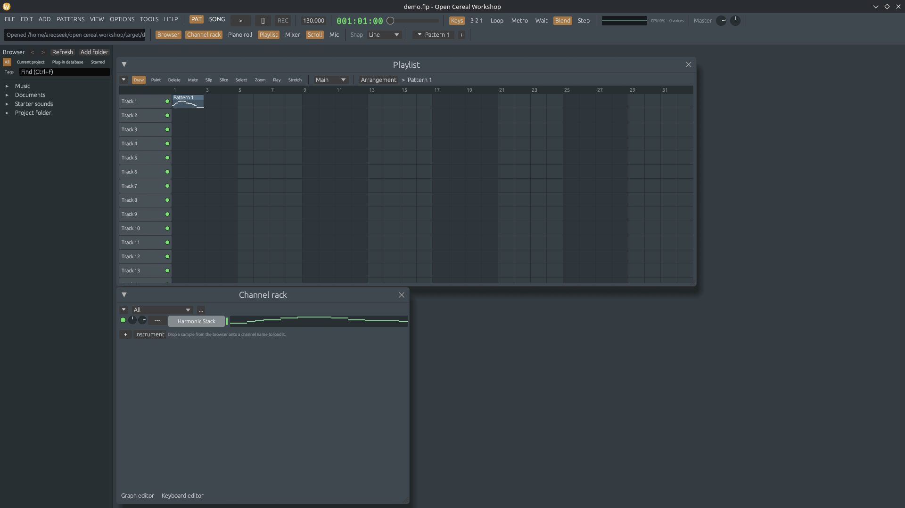
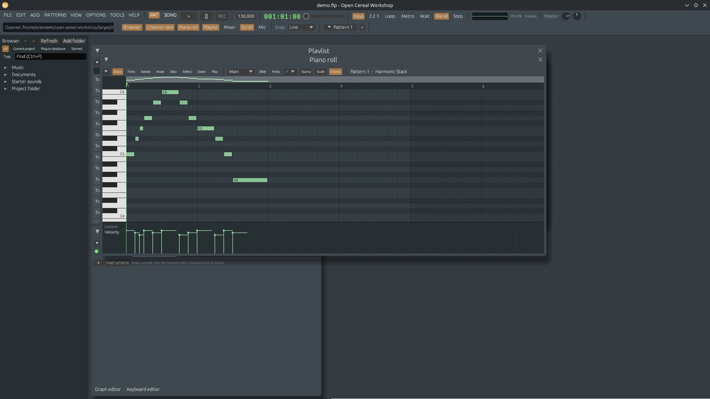
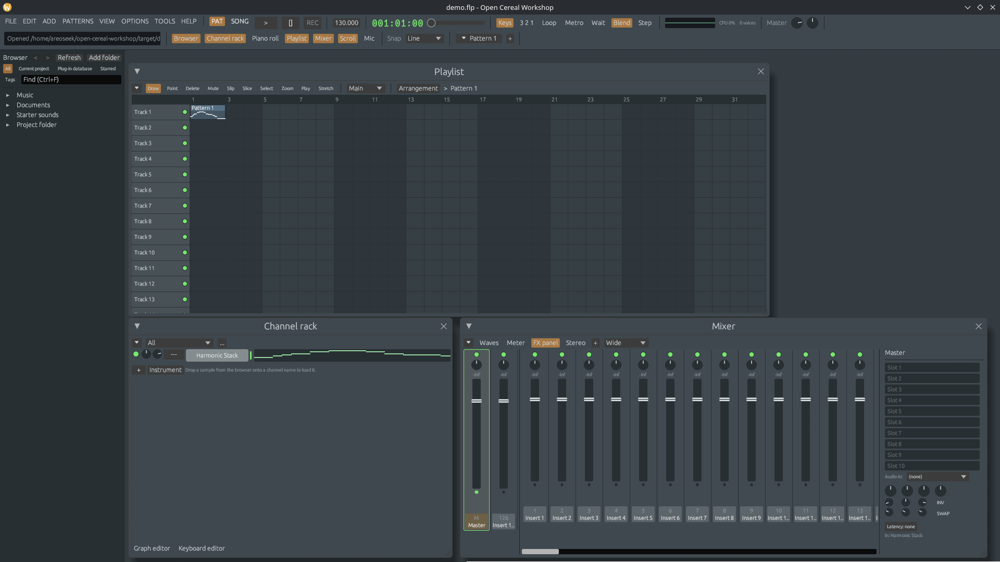
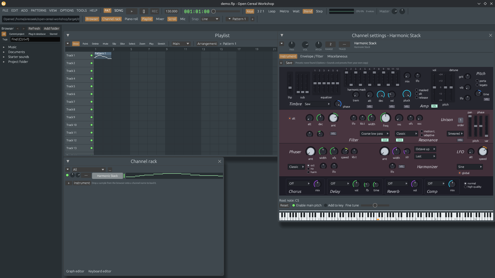

# Open Cereal Workshop

An open source, pattern-based music workstation written in Rust. Native on Linux, also built for Windows.

**Getting started:** installing a release, the first-start setup and adding plug-ins are explained in
[docs/GETTING-STARTED.md](docs/GETTING-STARTED.md).

> [!WARNING]
> **You must bring your own FL Studio installer file. We cannot include it, or anything from it.**
> This project ships none of FL Studio's samples, presets or demo songs, and never will: they belong to
> Image-Line. On first start the program asks for one thing: the FL Studio installer file, which **you download
> yourself** from Image-Line (the free trial is the same file). The program reads the sounds, presets, demo
> projects and templates out of that file into its own data folder on your disk. Nothing is installed or run,
> nothing is uploaded, and none of it is in this repository or in any release. Getting that file and
> following Image-Line's licence for what is in it is up to you. You can skip the step ("Not now" asks again
> next start, "Do not ask again" stops asking) and work with the built-in instruments and your own sample
> folders. It is always available under Options.

## What it is

Open Cereal Workshop is a digital audio workstation that aims to work like FL Studio, so that someone who
already knows that program can work from muscle memory: the same windows, menus, key bindings and mouse moves.
It opens and saves `.flp` project files, and every stock instrument and effect a project can name has a unit
of our own, under our own name, that reads the same stored settings. The interface drawing, the sounds and
the code are our own.

## Status

Early. This is one developer's project, written with AI assistance. A lot works, but expect rough edges,
missing pieces and sounds that are close rather than identical. There are no release builds yet; build from
source. Bug reports with a project file that shows the problem are the most useful kind.

## Screenshots

| Mixer | Additive synth panel (our own rebuild) |
|---|---|
|  |  |

## Build from source

There are no prebuilt downloads yet. You need a stable Rust toolchain (https://rustup.rs).

### Linux

Install the development packages for ALSA, xkbcommon, Wayland and OpenGL. On Debian or Ubuntu:

    sudo apt-get install libasound2-dev libxkbcommon-dev libwayland-dev libgl1-mesa-dev

On Arch the runtime packages are `alsa-lib libxkbcommon wayland libglvnd`.

Then:

    git clone https://github.com/areoseek/open-cereal-workshop
    cd open-cereal-workshop

    cargo build --release --locked -p open-cereal-workshop
    cargo run --release                      # start the application
    cargo run --release -- song.flp          # open a project

Optional, after building:

- `sh packaging/install.sh` puts the program, a menu entry, the icon and the `.flp` file type under
  `~/.local` (or under a prefix given as its first argument).
- `sh packaging/appimage.sh` makes a single-file AppImage in `target/`. It needs `appimagetool` on the PATH;
  without it the AppDir is left ready in `target/AppDir`.
- `cd packaging && makepkg -si` builds and installs an Arch package from the checked-out repository.

### Windows

Install Rust with rustup (the default MSVC toolchain, which needs the Visual Studio C++ build tools), then:

    cargo build --release --locked -p open-cereal-workshop

The program is `target\release\open-cereal-workshop.exe`. To make an installer, install Inno Setup and run
`iscc packaging\windows.iss`; the installer lands in `target\`. It can optionally put a desktop shortcut in
place and register `.flp` files.

### Continuous builds

`.github/workflows/build.yml` runs the tests and builds on Linux and Windows for every push and pull request,
and also produces the AppImage and the Windows installer as build artifacts. None of these packages has been
through a real release yet.

## First run

On first start the program asks for the FL Studio installer file you downloaded yourself (see the warning
above). It reads that file as data, without running anything in it, and copies only the content folders
(sounds, presets, demo projects and templates) into its own data folder. An installed copy can be used in place
instead. You can skip this and come back to it under Options.

Without that content you still get the built-in instruments and effects, a small starter kit of drum hits and
tones that the program generates itself, and your own sample folders. Projects that point at the original's
stock samples can only play them from your own copy.

A few features use things found on your machine: note scripts run in a Python 3 you have installed (each script
only after you have allowed that exact text), and the General MIDI player uses a DLS or SF2 sound bank if one is
found. The stem splitter downloads its model weights (142 MB, from zenodo.org) the first time you use it.

## What works today

The full, per-item list is in [docs/PARITY.md](docs/PARITY.md). In short:

**Project files**
- `.flp` projects open and save. A project opened and saved without changes comes back byte for byte; edits are
  patched into the original file, so settings we do not understand yet are kept.
- Preset, channel state, mixer track state and score files (`.fst`, `.fsc`) load and save.
- Projects from versions 4 to 8 are read, including the early mixer layout.
- Zipped loop packages are written and opened. Autosave into a backup folder, with Revert to last backup.

**Windows and editing**
- Channel rack with step sequencer, graph editor and keyboard editor; channel groups and zipped channels.
- Piano roll with its eight tools, slide and portamento notes, control lanes, scale highlighting and the helper
  tools (quantise, chop, arpeggiate, strum, flam, randomise and others). Score export to PDF.
- Playlist with pattern, audio and automation clips, several arrangements, time and time signature markers, and
  performance mode.
- Mixer with inserts, sends, routing, track EQ, ten effect slots, sidechain routing and plug-in delay
  compensation.
- Browser, event editor, channel settings (sample, miscellaneous and envelope/filter pages), project information,
  settings, and a built-in audio editor (Wave Recorder).
- Main menus and window menus with the usual entries in the usual places. Playlist, channel rack, piano roll and
  mixer can be detached into their own windows.
- Key and mouse bindings follow the original; see [docs/KEYBINDINGS.md](docs/KEYBINDINGS.md).

**Measured against the original**

Several parts have been checked against renders of the original and agree to within the rounding of a 16-bit
render, or within a stated small margin:

- The sampler's envelope and filter page (all eight filter types), sample treatments, resampling, the channel
  time, arpeggiator and echo settings, clip fades and automation clip curves.
- Instruments: Triple Osc and Sweep Kick match; Analog Trio agrees on most test renders (564 of 640 within a
  hundredth of the level); the electric piano unit, Sound Bank Player and the multi-sample player are measured
  for most of their laws; Harmonic Stack is measured for its voice (filter, envelopes, timbres, pluck, detune,
  grit, tremolo, vibrato, phaser, harmonizer, slow oscillator, unison, slides) and for its built-in chorus, echo, room and compressor.
- Effects: Seven Band EQ (both versions), the parametric EQ, Bass Lift, Overdrive, Chorus, Plain Echo, the
  second delay, Three Band Compressor, Band Maximiser, Loudener, Room Reverb (classic), the limiter, flanger,
  phaser, soft clipper, stereo enhancer, stereo shaper, transient processor, panning units and fast distortion
  and low-pass units. The compressor and the newer reverb match in most, but not all, settings.

**Instruments and effects**
- Every stock instrument (51) and effect (90) a project can name opens as a unit of ours, reads its stored
  settings and saves them back. Most of them play; how close each one is is listed per unit in PARITY.md.
- Third-party plug-ins: CLAP, VST3 and VST2 plug-ins installed on your machine are hosted. A project that names
  one that is installed opens it with its saved state. On Linux, Windows-only plug-ins can be used through a
  bridge such as yabridge.

**Audio and MIDI**
- Audio recording from an input device onto the playlist or into a Wave Recorder, with latency compensation.
- MIDI keyboards and controllers play the selected channel and record into patterns; knobs and sliders can be
  linked to any automatable control and the links are saved in the project.
- MIDI output to other programs and hardware, and master sync as MIDI clock.
- Automation recording of controls moved while recording.

**Export**
- WAV (16, 24, 32-bit float), FLAC, MP3, Ogg Vorbis and MIDI.
- Whole song, pattern or time selection; tail options; one file per mixer track; dithering; markers as cue
  points.
- Stem splitting of an audio clip into drums, bass, instruments and vocals.

**Platforms**
- Linux (X11 and Wayland) is the main platform.
- Windows builds and passes the tests in continuous integration.

## What is still missing or approximate

Most of the program is marked "approximate" in PARITY.md: it works, but has not yet been measured against the
original, so levels, curves and scales are close rather than identical. The main gaps:

**Instruments**
- Approximate, with scales estimated: Six Op, Harmonic Forge, Morph Additive, Duo Synth,
  String Model, Hybrid Synth, Triple Synth, Hornet and Hornet XT, Pocket Synth, Saw Synth, Kick Designer,
  Membrane Drum, Drum Modeler and others. Many have parts not done yet (for example the second layer and
  resynthesis in Harmonic Forge, built-in arpeggiators and step runners in several synths).
- Plays only a plain version of the sound: Vintage Poly II, Acid Line (its knobs could not be placed), Metal
  Stack.
- Uses stand-in sounds of our own: Pack Player (the original's sound packs are protected files that we do not
  unlock), Drum Bank (the recorded drum waves), the plucked bass, and the text-to-speech voice.
- Open but silent or doing nothing: Mobile Rack and Mobile Modules, Loop Slicer 2, Video Player, Rewire Link,
  Dancer, Voltage Sender. Their settings are kept and saved untouched.

**Effects**
- Approximate, with stored settings placed by comparing many files, so a few settings may be on the wrong knob:
  Pad Effects, Finisher, Hertz Shifter, Crusher, Bucket Chorus, Stone Phaser, Pedal Board, Grain Shifter, Voice
  Tuner, Relooper, Attack Splitter and others.
- The visual units (Visual Stage, keyboard lighting) pass sound through but show nothing.
- The meters and scopes do not read their saved display options.
- The stem splitter is rougher than the original's; drum machines and synthesizers bleed into the instruments
  part.

**Third-party plug-ins**
- DirectX plug-ins and VST2 shell files are not hosted.
- A plug-in's own window floats; it cannot be docked inside ours, and key presses are not passed on to it.
- The VST3 editor window on Windows is written but not yet tried on a Windows machine.
- A project naming a plug-in that is not installed keeps its block untouched and lists it when the project
  opens; a setting (Settings, Audio: "Stand-in voice for missing plug-ins") lets a plain voice of ours play in
  its place.
- No note expression, and no more than one stereo input and output per plug-in.

**Windows, menus and settings**
- Some menu entries are shown and remembered but have nothing behind them yet, and some are left out: video
  export, M4A, theme settings, MIDI remote, and others listed in PARITY.md.
- Settings not done: MIDI controller type and per-device input port, sync offset, and many of the playback,
  mixing-quality and file options.

**Project files**
- Projects saved by the unregistered trial are locked by the trial and are refused with a message.
- The built-in bass synth of versions 4 and 5 stays silent; early mixer send and pan scales are estimated.

**Packaging and platforms**
- No release has been made. The AppImage, Arch package and Windows installer scripts are written but untested in
  a real release. There is no Flatpak.
- Windows gets less day-to-day testing than Linux.

See [docs/ROADMAP.md](docs/ROADMAP.md) for what is planned next.

## Key bindings

[docs/KEYBINDINGS.md](docs/KEYBINDINGS.md) lists every binding, marked as done, partly done (with the
difference noted) or still to do.

## Ground rules

This is a clean-room project. The behaviour is worked out by using the public demo like any user, from the
public manual and tutorials, from general audio literature, and from project files we save ourselves. The
original program is never decompiled, disassembled, debugged or read in memory. No samples, presets, demo
songs, impulse responses, artwork, icons, skins or manual text from the original are copied or shipped, and our
units carry names of our own. Details are in [docs/GROUND-RULES.md](docs/GROUND-RULES.md); the sources of any
sounds we ship are in [docs/CONTENT-SOURCES.md](docs/CONTENT-SOURCES.md).

## Licence

GPL 3.0 or later; see [LICENSE](LICENSE). Code from other open projects and its licences is listed in
[docs/THIRD-PARTY.md](docs/THIRD-PARTY.md).

## Disclaimer

Open Cereal Workshop is an independent project. It is not affiliated with, endorsed by or connected to
Image-Line. FL Studio is a trademark of Image-Line; other product names mentioned here belong to their owners
and are used only to describe compatibility.
