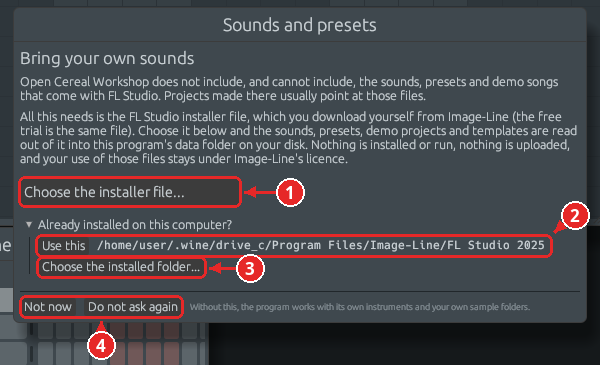
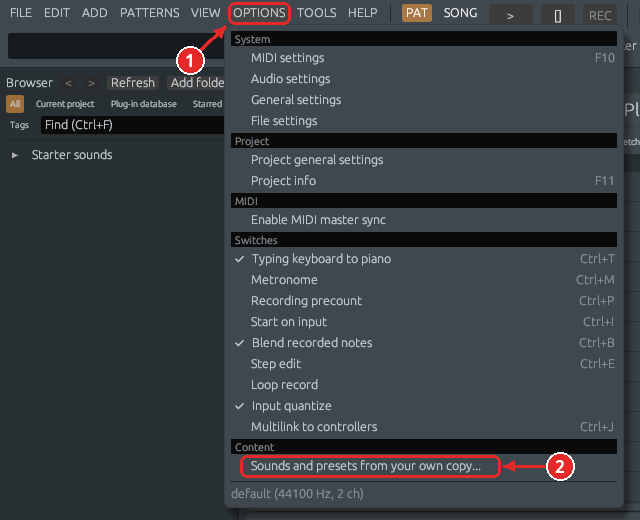
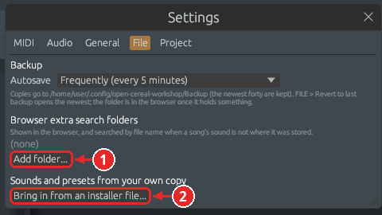
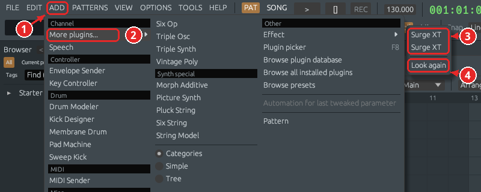
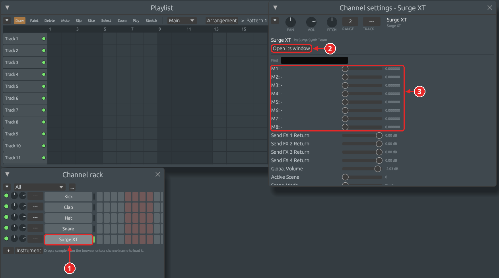
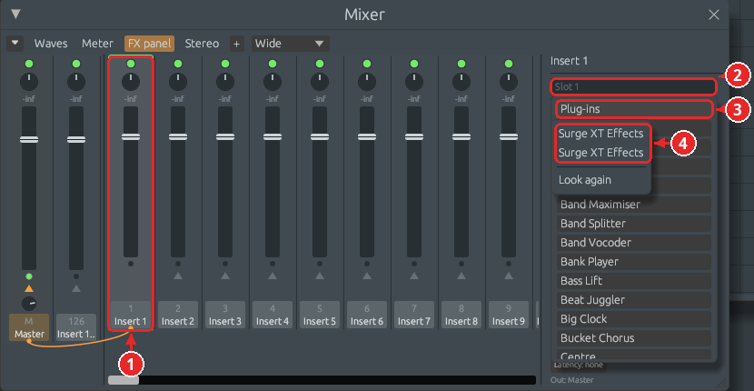
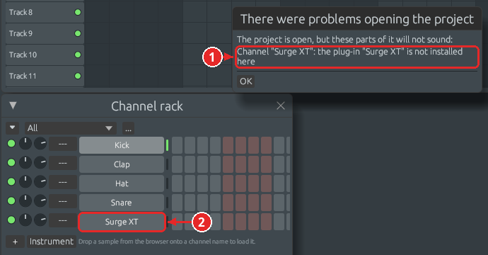
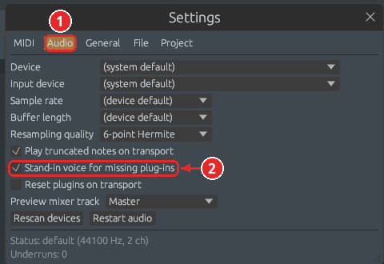

# Getting started

This guide is for people who already know FL Studio and have just downloaded Open Cereal Workshop 0.01. It
covers installing the program, the first-start setup step, adding your own plug-ins, and the most common
problems.

Open Cereal Workshop is an independent project. It is not made by or connected to Image-Line. FL Studio is a
trademark of Image-Line.

## 1. Install the program

Pick the file for your system from the release page.

### Debian or Ubuntu (`open-cereal-workshop_0.01_amd64.deb`)

For Debian 12 or newer and Ubuntu 22.04 or newer.

1. Open a terminal in the folder where the file was saved.
2. Run `sudo apt install ./open-cereal-workshop_0.01_amd64.deb`
3. Start **Open Cereal Workshop** from the application menu, or run `open-cereal-workshop`.

The package adds a menu entry, an icon and the `.flp` file type. To remove it later, run
`sudo apt remove open-cereal-workshop`.

### Any other Linux (`open-cereal-workshop-0.01-linux-x86_64.tar.gz`)

For any 64-bit Linux with glibc 2.35 or newer.

1. Unpack it: `tar xzf open-cereal-workshop-0.01-linux-x86_64.tar.gz`
2. Go into the folder: `cd open-cereal-workshop-0.01-linux-x86_64`
3. Either start it in place with `./open-cereal-workshop`, or run `sh packaging/install.sh` to put the program,
   a menu entry, the icon and the `.flp` file type under `~/.local`. Make sure `~/.local/bin` is on your `PATH`.

### Windows (`open-cereal-workshop-0.01-windows-x86_64.zip`)

For 64-bit Windows 10 or newer.

1. Right-click the zip file and choose **Extract All**.
2. Open the extracted folder and double-click `open-cereal-workshop.exe`.
3. Windows may warn that the program is unsigned. See [Troubleshooting](#5-troubleshooting).

The zip has no installer. It does not add a Start menu entry or register `.flp` files.

## 2. First start: sounds and presets from your own FL Studio download

Open Cereal Workshop ships none of FL Studio's samples, presets, demo songs or templates. Projects made in FL
Studio often point at those files. So on first start the program asks you to point it at a copy of FL Studio
that **you obtained yourself**.

### Get FL Studio from Image-Line

1. Go to Image-Line's own website (image-line.com) and open the FL Studio download page.
2. Download the **Windows** installer (a `.exe` file). The free trial download is fine: it is the same file.
   Use the Windows file even on Linux. The macOS download will not work here.

You do not need to buy anything for this step, and you do not need to run the installer, unless you want to
use an installed copy (see below). Getting the file and following Image-Line's licence for what is in it is up
to you.

### The setup window

The first time the program starts, it shows a window called **Sounds and presets**.

You have three ways to go:

1. **Choose the installer file...** Pick the FL Studio `.exe` you downloaded. A progress bar counts the files.
   You can press **Cancel** at any time.
2. **Already installed on this computer?** Click this line to open it. If the program found an installed copy,
   it is listed with a **Use this** button. Click **Use this**.
3. **Choose the installed folder...** If your installed copy was not found, click this and pick the FL Studio
   folder: the one that holds the `Data` folder. Picking a folder inside it, or the `Image-Line` folder that
   holds it, also works.
4. **Not now** closes the window and asks again at the next start. **Do not ask again** stops the question.
   You can still do the step later (see [Doing the step later](#doing-the-step-later)).

When it is done, the line at the top left of the main window says "Using your own content from" and the folder.
If a project was already open, it is opened again so that its samples are found.

### Which option to choose

**The installer file (Windows and Linux).** This is the simplest way, and on Linux it needs no Wine. The
program reads the installer as data. Nothing in it is installed or run. It takes out only content:

- the `Patches` folder (presets and the sample packs),
- the `Demo projects`, `Projects` and `Templates` folders,
- the sample sets of the built-in instruments (sound files only).

Program files (`.exe`, `.dll` and the like) are never taken. The content is written to this program's data
folder on your own disk:

- Linux: `~/.local/share/open-cereal-workshop/content`
- Windows: `%LOCALAPPDATA%\open-cereal-workshop\content`

Nothing is uploaded anywhere, and none of it is part of Open Cereal Workshop.

**An installed copy.** If FL Studio is already installed, the program can read the content straight from that
folder while it runs. Nothing is copied.

- Windows: install FL Studio the normal way. Copies under `Program Files\Image-Line` are found automatically.
- Linux: you can install FL Studio under Wine. Copies in `~/.wine`, in the prefix named by `WINEPREFIX`, in
  `~/.local/share/wineprefixes`, in Bottles bottles and in `~/Games` are found automatically. Any other folder
  can be picked with **Choose the installed folder...**

### What the program reads

From your copy, the program uses:

- presets for its own instruments and effects,
- samples that projects point at, so old projects sound the way they were saved,
- the sample sets of instruments that need them,
- the demo projects and templates.

In the browser on the left, new entries appear: **Packs**, **Presets**, **Demo projects** and **Templates**.
The folder you chose is remembered in the settings file, so the window does not come back. If that folder is
deleted later, the program asks again.

### If you skip it

The program still works. You get:

- all the built-in instruments and effects,
- a small set of starter drum hits and tones the program makes itself (**Starter sounds** in the browser),
- your own sample folders.

A project that points at FL Studio's stock samples opens, but those samples stay silent. The line at the top
left says how many samples were not found.

### Doing the step later

Two places open the same window again:

- **OPTIONS** menu, **Sounds and presets from your own copy...** at the bottom.
- **OPTIONS**, **File settings**, button **Bring in from an installer file...**

1. Click **OPTIONS** in the main menu.
2. Click **Sounds and presets from your own copy...**

If you chose **Do not ask again** and want the question back at start, open **OPTIONS**, **General settings**
and tick **Offer to bring in sounds from your own copy when none are found**.

## 3. Third-party plug-ins (VST2, VST3, CLAP)

Open Cereal Workshop hosts CLAP, VST3 and VST2 plug-ins that are installed on your computer. There is no
separate plug-in manager window: plug-ins are found by scanning folders, and installed ones are listed in the
menus that add instruments and effects.

### Where plug-ins are looked for

The program looks in these folders and in their subfolders.

**Linux**

- `~/.clap`, `~/.vst3`, `~/.vst`, `~/.lxvst`
- `clap`, `vst3`, `vst` and `lxvst` under `/usr/lib`, `/usr/local/lib` and `/usr/lib64`
- the folders named in the `CLAP_PATH` and `VST_PATH` environment variables

**Windows**

- `C:\Program Files\Common Files\CLAP` and `C:\Program Files\Common Files\VST3`
- `%LOCALAPPDATA%\Programs\Common\CLAP` and `%LOCALAPPDATA%\Programs\Common\VST3`
- `C:\Program Files\VSTPlugins`, `C:\Program Files\Steinberg\VSTPlugins`, `C:\Program Files\Common Files\VST2`
  and `C:\Program Files\Common Files\Steinberg\VST2`
- the folders named in the `CLAP_PATH` environment variable

**Both:** every folder you add as a browser search folder is scanned for plug-ins too.

The first time a plug-in list is opened, the folders are scanned. Each plug-in file is looked at by a second
copy of the program, so a plug-in that crashes or hangs is only left out of the list. The results are kept in
`plugins.txt` next to the settings file, and a file is only looked at again when it changes.

On Linux, Windows-only plug-ins can be used through a bridge such as yabridge, which presents them as VST3 or
CLAP plug-ins in the folders above.

### Add a plug-in folder

1. Open **OPTIONS**, **File settings** and click **Add folder...** under **Browser extra search folders**.
   (The **Add folder** button at the top of the browser does the same.)
2. **Bring in from an installer file...** on the same page is the setup step from section 2.

Pick the folder that holds your plug-ins. The list is scanned again the next time you open it.

### Put a plug-in on a channel

1. Click **ADD** in the main menu. (The **Instrument** button at the bottom of the channel rack, and **Insert**
   or **Replace** in a channel button's right-click menu, open the same list.)
2. Point at **More plugins...** at the top of the first column.
3. Click the plug-in. A new channel with it appears in the channel rack.
4. **Look again** scans the plug-in folders again. Use it after installing a new plug-in, or to retry a file
   that failed. Files that could not be opened are named under this button.

Only instruments are listed here. A plug-in installed in two formats (for example CLAP and VST3) appears twice
with the same name. Either one works, but see the note on editor windows below.

### Open the plug-in's settings and editor

1. Click the channel's name button in the channel rack. The channel settings window opens.
2. **Open its window** shows the plug-in's own editor in a separate, floating window. The first time a plug-in
   is opened, its editor comes up by itself. The button then reads **Close its window**.
3. Below, every setting the plug-in lists is shown as a slider with the plug-in's own value text. Right-click a
   slider to automate it or link it to a MIDI controller. Double-click to reset it. A **Find** box filters long
   lists.

If there is no **Open its window** button, the plug-in did not offer an editor window this program can show.
Its settings are still all in the list. Some plug-ins show their editor in one format and not in the other, so
try the plug-in's other format if you have it.

The editor window cannot be docked inside the main window, and key presses are not passed on to it.

### Put a plug-in in a mixer effect slot

1. Open the mixer (**F9**, or **Mixer** on the toolbar) and click the mixer track you want.
2. Click an empty slot in the panel on the right. For a filled slot, right-click it.
3. Point at **Plug-ins** at the top of the menu.
4. Click the effect plug-in. It goes in that slot and its settings window opens, with the same **Open its
   window** button and slider list as above.

Only effects are listed here. The rest of the menu lists this program's own effects.

### Projects that name a plug-in you do not have

When a project names a third-party plug-in that is installed here, it opens with the state the project saved.

When the plug-in is not installed, the project still opens:

1. A window called **There were problems opening the project** lists each part that could not be opened as it was saved, for
   example: Channel "Surge XT": the plug-in "Surge XT" is not installed here. Click **OK**.
2. The channel stays in the rack under its name. Its settings window says the plug-in is not installed.

The plug-in's saved settings are kept untouched and are written back when you save. Once you install the
plug-in, the channel works again.

By default, such a channel plays a plain voice of our own instead of staying silent, so you can still hear its
notes. FL Studio keeps these channels silent. To switch the stand-in off:

1. Open **OPTIONS**, **Audio settings**.
2. Untick **Stand-in voice for missing plug-ins**. This takes effect from the next project you open.

### Not supported yet

- DirectX plug-ins and VST2 shell files.
- Note expression, and more than one stereo input and output per plug-in.

## 4. FL Studio's own plug-ins

> [!IMPORTANT]
> **Open Cereal Workshop never loads Image-Line's plug-in program files.** The setup step takes only content
> (presets, samples, demo projects, templates) from your FL Studio download, and the plug-in scan does not
> look in the FL Studio folder.
>
> Projects that use FL Studio's built-in instruments and effects still open. Each of those plug-ins opens as
> an instrument or effect of our own, under our own name, that reads the settings saved in the project and
> writes them back. For example, a channel that used the stock three-oscillator synth opens as **Triple Osc**.
>
> How close each one comes is listed per plug-in in [PARITY.md](PARITY.md): `[x]` means measured against the
> original, `[~]` means it works but is approximate. A few play only a stand-in voice or stay silent; their
> settings are still kept.
>
> If you own Image-Line's separately sold VST versions of their plug-ins, install them like any other
> plug-in. They are then found and hosted like any third-party plug-in (on Linux, through a bridge such as
> yabridge, as with any Windows plug-in).

## 5. Troubleshooting

**A plug-in does not appear in the list.**

- Check that it is in one of the folders in section 3, or add its folder with **Add folder...**
- Open the list and click **Look again**. Files that could not be opened are named under that button.
- Check that it is the right sort: instruments are listed under **ADD**, **More plugins...**; effects under
  **Plug-ins** in a mixer slot.
- On Linux, Windows `.dll` and `.vst3` files need a bridge such as yabridge.
- DirectX plug-ins and VST2 shell files are not supported.
- To force a full rescan, close the program and delete `plugins.txt` in the settings folder:
  `~/.config/open-cereal-workshop` on Linux, `%APPDATA%\open-cereal-workshop` on Windows.

**The plug-in's editor does not open.** Its settings are always available as sliders in its settings window.
Try the plug-in's other format if you have it. On a Wayland desktop, VST3 editors run through XWayland.

**Linux: the program does not start, or says a library is missing.** The tarball needs the usual desktop
libraries. Run `ldd ./open-cereal-workshop | grep "not found"` to see which are missing. On Debian or Ubuntu:

    sudo apt install libasound2 libxkbcommon0 libxkbcommon-x11-0 libgl1 libx11-6 libxcursor1 libxi6 libxrandr2 libwayland-client0

On Arch: `sudo pacman -S alsa-lib libxkbcommon libxkbcommon-x11 libglvnd libx11 libxcursor libxi libxrandr wayland`

**Linux: "Choose the installer file..." or "Add folder..." does nothing.** File dialogs use the desktop's file
chooser service (`xdg-desktop-portal`), or `zenity` if that is missing. Install one of them.

**Linux: no sound.** Open **OPTIONS**, **Audio settings**, pick a device and click **Restart audio**. The
**Status** line at the bottom shows what was opened.

**Windows: "Windows protected your PC".** The program is not signed, so SmartScreen warns about it. Click
**More info**, then **Run anyway**. Only do this for a file you downloaded from the project's own release page.

**The setup step says the folder "does not look like an installed copy".** Pick the FL Studio folder that
holds the `Data` folder, with `Data/Patches` inside it.

**A project opens but some samples are silent.** The line at the top left says how many samples were not
found. Do the setup step from section 2, or add the folder that holds the samples with **Add folder...** in
**File settings**: missing samples are searched for by file name in those folders.

**Projects saved by the FL Studio trial are refused.** The unregistered trial locks the projects it saves, and
this program leaves that lock alone.

### For advanced users

These environment variables are read at start:

- `CEREAL_FACTORY_DATA`: one or more installed FL Studio folders (separated like `PATH`) to read content from.
  When it is set, the setup window does not appear.
- `CEREAL_SAMPLE_DIRS`: extra folders searched for samples.
- `CEREAL_NO_SETUP`: do not show the setup window at all. (It also stops the list of recent projects from
  being saved.)
